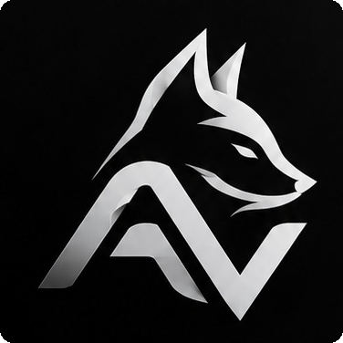

# Arthur Victor

**Desenvolvedor de sites e sistemas**  
Estudante de Análise e Desenvolvimento de Sistemas · IFPB

Crio soluções digitais com foco em **simplicidade, funcionalidade e boa experiência de uso**.

[LinkedIn](https://www.linkedin.com/in/arthur-victor-128a10294/) · [Meus repositórios](https://github.com/ArthurVictorAV?tab=repositories)

---

### Sobre mim

Desenvolvo sites e sistemas e busco transformar ideias em aplicações úteis. Além dos projetos próprios, aprofundo meus conhecimentos em programação, banco de dados e desenvolvimento de software no **IFPB**.

### Tecnologias

**Front-end:** React · JavaScript · HTML · CSS  
**Back-end:** Node.js · Java · Python  
**Banco de dados e ferramentas:** PostgreSQL · SQL · Git · GitHub

### Projetos em destaque

| Projeto | Descrição |
| :--- | :--- |
| [**Camisa Acadêmica**](https://github.com/ArthurVictorAV/CAMISA-ACADEMICA) | Site para compra de fardamento universitário. |
| [**POO com JavaFX**](https://github.com/ArthurVictorAV/P00-JAVAFX) | Projetos e exercícios de orientação a objetos com interfaces em JavaFX. |
| [**POO — IFPB**](https://github.com/ArthurVictorAV/POO-IFPB) | Implementações e estudos de programação orientada a objetos em Java. |

  Arthur Victor · Developer

